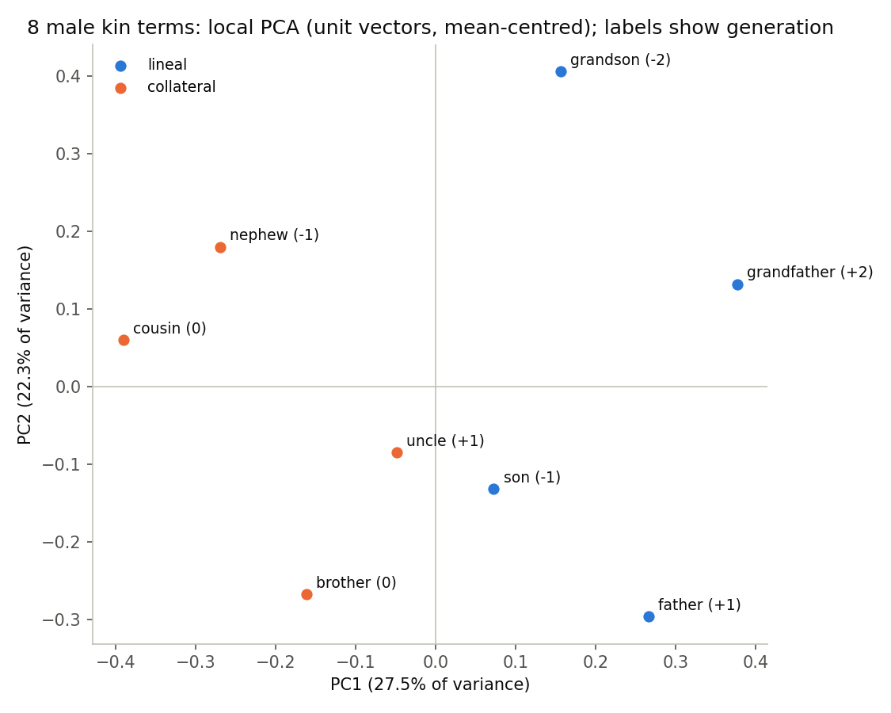
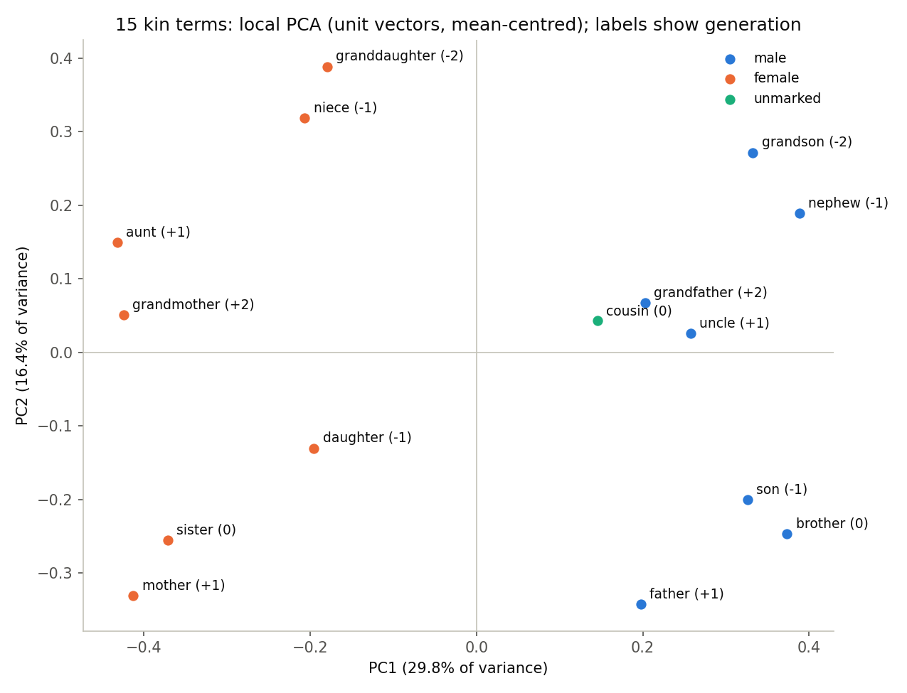
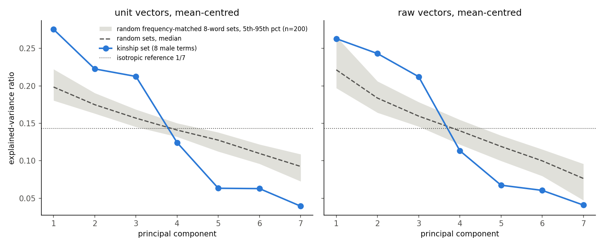

# Kinship local-PCA experiment on GloVe 6B 300-d: results

Design: `research_notes/Local origins in word embeddings/experiments_and_pitfalls.md` (Key questions 2, 3, 6) and
`reports/Local origins in word embeddings.md` ("An afternoon's experiment"). Script: `kinship_pca.py` (see README).

| item | value |
|---|---|
| vectors | `glove-wiki-gigaword-300` via gensim-data = GloVe 6B 300-d (Wikipedia 2014 + Gigaword 5, lowercased); file `~/gensim-data/glove-wiki-gigaword-300/glove-wiki-gigaword-300.gz` |
| vocabulary | 400,000 x 300, frequency-ordered (`the , . of to and in a ...`); frequency rank = vocabulary index |
| seed | 0 (one `SeedSequence`, spawned into five independent generators: permutations, 8-word null, 15-word null, transfer directions, offset null) |
| nulls | 200 frequency-matched random sets (each word drawn from rank band [r/2, 2r], alphabetic tokens only); 20,000 Monte-Carlo shuffles with the Phipson-Smyth +1 only where exact enumeration exceeds 500,000 labellings; 10,000 random unit directions; 10,000 random-pair offsets |
| run time | 77 s total on the recorded run (55 s reading the file; PCA + permutation tests 11 s; transfer 2.4 s; random-set nulls, offsets, analogies, plots 8 s); a first run with the same seed took 69 s and produced identical numbers |
| software | Python 3.9.6, numpy 1.26.4, scipy 1.13.1, gensim 4.3.3, matplotlib 3.9.4; run 2026-11-01 |
| primary configuration (declared before running) | unit-normalised vectors, mean-centred; medoid centring and raw vectors are reported as secondary |

The sign convention for every PC is "grandfather scores >= 0". All correlations are Spearman rho for ordinal labels
(generation, |generation|, log frequency rank) and point-biserial r for binary ones (lineal, sex). "p_max" is the
permutation p-value of the pre-registered statistic max over PC1..PC3 of |corr|, so the search over three PCs is inside
the null; single-PC p-values are shown for reading but are unadjusted.

## Plain-English reading

**Prediction 1, "sex will be PC1 of the mixed-sex set": held, decisively.** PC1 of the 15-term set (29.8% of variance,
eigengap lambda1/lambda2 = 1.82) separates the seven male from the seven female terms perfectly; point-biserial r = 0.958
(exact p = 0.0006, the floor of 2/3,432 labellings), far outside the frequency-matched random-set null (95th percentile
0.60, maximum 0.77 over 200 sets; p = 0.005, the floor). PC1 is stable under every leave-one-out (all cosines >= 0.97).
"cousin" lands on the male side (+0.15). As the report anticipated, this is a rediscovery of the gender direction, not a
new result.

**Prediction 2, "generation second, as an ordered axis": partly held, in a weakened and reshaped form.**
Generation is *not* second. In the mixed set PC2 is frequency (Spearman with log rank = 0.94) and generation appears on
PC3 (15.0%): rho = +0.78 (single-PC Monte-Carlo p = 0.0011; p_max = 0.0031; random-set p = 0.005, kinship max|rho| 0.78
against a null maximum of 0.77), and on raw vectors rho = +0.91 (p_max = 1.5e-4). Two qualifications. (i) PC2, PC3 and PC4
have nearly equal eigenvalues (16.4%, 15.0%, 13.7%), and the leave-one-out cosines show PC2 rotating (0.10 when "mother"
is dropped), so "generation is PC3" names a direction inside a three-dimensional subspace that is only defined up to
rotation; what is robust is that an ordered generation direction lives among components 2-4, below sex. (ii) The axis is
mostly a three-valued ascending / same / descending contrast, not an equal-step line: on the male-built supervised axis the
held-out female terms project at +1.4, +1.4, +0.8 (grandmother, aunt, mother), +0.08 (sister), -1.0, -1.2, -1.4 (niece,
granddaughter, daughter), with the +-2 and +-1 terms not in order within each side. The offset test says the same thing
geometrically: cos(father - son, grandfather - father) = -0.07, i.e. the "parent minus child" step and the "grandparent
minus parent" step are orthogonal (far from the chain null of -0.50, but nowhere near the +1 that a straight generation
line would give), while grandfather - father is parallel to grandson - son (cos 0.64, exploratory) and father - son is
parallel to mother - daughter (0.63). In the single-sex 8-word set the pre-registered primary test *failed*: PC1 of the
unit-normalised, mean-centred male set correlates with generation at rho = 0.36 (exact p = 0.37 over 5,040 labellings);
the best of the top three PCs is PC3 at rho = 0.67 (p_max = 0.23; random-set percentile 77). On raw vectors PC3 reaches
rho = 0.82 (p_max = 0.048; random-set p = 0.07), borderline and not robust to normalisation. The supervised transfer is the
positive evidence: a generation axis built from four male pairs orders the seven held-out female terms at rho = +0.87 (raw
vectors; label-permutation p = 0.022; random-direction p = 0.074) and +0.98 (unit vectors; p = 0.0016 and 0.0044), and the
female-built axis orders the male terms at +0.82 / +0.87 (p_perm = 0.04 / 0.02, p_dir = 0.08 / 0.06). Across the ten
held-out generation tests the sign is correct every time and rho is 0.79-0.98, nine of ten pass the label-permutation
null at 0.05, but only three of ten pass the stricter random-direction null (which is demanding here: 5% of random
directions in this anisotropic space order seven kin terms at |rho| >= 0.87). The male- and female-built generation axes
have cosine 0.69 (isotropic reference sd 0.06), so the generation direction is roughly parallel across sexes.

**Prediction 3, "lineality a weak third": failed, in the opposite direction.** Lineality is the strongest non-sex
structure in the data. With sex held constant it is PC1 of the male set: lineal (grandfather, father, son, grandson)
versus collateral (uncle, brother, nephew, cousin) are perfectly separated on PC1, r = 0.87 (exact p = 0.029, the floor
of 2/70; p_max = 0.029), and the kinship set sits at the 99.5th percentile of the random-set null for this statistic
(p = 0.010); raw vectors give r = 0.91 (random-set p = 0.015). The supervised test is the strongest result in the
experiment: the axis mean(male lineal) - mean(male collateral) separates the seven held-out female terms perfectly with
r = 0.99 (all four lineal terms at +1.2 to +1.6, all three collateral terms at -0.35 to -0.65), beating 10,000 random
directions at p = 0.0002 (random-direction 95th percentile 0.79); the reverse direction gives r = 0.98 (p = 0.0007), and
the male- and female-built lineality axes have cosine 0.77. The lineality axis is nearly orthogonal to the generation
axis (cos 0.03). The one place lineality is absent is the top three PCs of the mixed set (max |r| = 0.13, p = 0.96,
random-set percentile 4.5): there sex, frequency and generation take the first three slots. A post-hoc look (not
pre-registered, reported as exploratory) finds it on PC4: r = 0.97 (single-PC exact p = 0.0002), and 96% of the centred
lineal label's variance lies in span(PC1..PC4) against 2% in span(PC1..PC3). So the mixed cluster's first four axes are
sex, frequency, generation (ascending/descending) and lineality, with the last three nearly degenerate in variance.

**Frequency confound: confirmed, and it is PC2.** In both sets the second component is log frequency rank (rho = 0.95
in the male set, 0.94 in the mixed set, unit vectors; 0.71 and 0.80 raw). The |generation| label, which the report
predicted would track rarity in a V-shape, loads on exactly that component (rho = 0.54 male, 0.55 mixed), and nowhere
else that survives the max-statistic (p_max = 0.11 in both sets). Signed generation is not frequency (PC3 vs log rank
= +0.31 male, -0.04 mixed). One more confound is in the labels themselves: the pre-registered lineal and |generation|
labels correlate at about 0.7 in both sets (lineal terms are the +-1 and +-2 terms), so "|generation| on PC1 of the male
set" (rho = 0.77, p_max = 0.11) is the lineality result wearing a different label, not an independent finding.

**Reading across the three predictions.** With sex removed, the embedding's geometry looks less like the Wallace-Atkins
signed-generation line the report expected and more like Romney-D'Andrade: a direct/collateral split (PC1 of the male
set, and the cleanest transferable direction), an ascending/descending (reciprocity) contrast, and only a weak distance
feature that is mostly frequency. The report's predicted ordering sex > generation > lineality held only for the first
slot; below sex the order is frequency, then generation and lineality at roughly equal variance, with lineality the more
linearly separable of the two.

**Other safeguards.** Medoid centring behaves exactly as the notes warned: the medoid-centred PC1 has |cos| = 0.99
with the mean-minus-medoid direction in all four cases and takes 51-55% of the variance, so it is a fact about one word
(brother or nephew in the male set, daughter or father in the mixed set), and it is unstable (PC1 swaps when 5 of the 8
male words are dropped). The 8-word spectrum is steeper than frequency-matched random sets (top three PCs 71% of variance
against a null median of 53%; EVR_1 = 0.275 at the 99.5th percentile, p = 0.010), but the first three eigenvalues are
nearly equal (lambda1/lambda2 = 1.24, lambda2/lambda3 = 1.05), so the individual axes are poorly defined: PC1 drops below
the 0.9 leave-one-out criterion when grandfather (0.77), father (0.89), nephew (0.89) or cousin (0.68) is removed, and
PC2 falls to 0.21-0.42 for four of the drops. The 8-word unsupervised axes are therefore properties of the word list as
much as of the space, which is why the transfer tests, not the PCs, carry the conclusions. The Linzen check confirms
the known artefacts: without exclusion, father : son :: grandfather : ? returns "grandfather"; with exclusion it returns
"grandson", but "grandson" is already the second neighbour of "grandfather" alone (ONLY-B), so the offset adds little;
father : uncle :: mother : ? is the one query where the offset genuinely helps (aunt at rank 1 versus rank 8 for ONLY-B).

## Deviations from the notes, and post-hoc additions

- 200 random sets (as instructed) rather than the notes' 1,000, so the random-set p-value floor is 1/201 = 0.005.
- Random replacement words are restricted to alphabetic tokens in the rank band (numbers and punctuation excluded) and
  may not be kinship words or repeat within a set; declared before running.
- Cousin is sex-unmarked, so the binary sex correlation uses the 14 marked words (PCA still on all 15; C(14,7) = 3,432
  labellings enumerated exactly); a secondary three-level ordinal sex label with cousin = 0 is also reported.
- Exact enumeration was used wherever feasible (<= 500,000 labellings): 8-word labels (5,040 / 420 / 70), 14-word sex
  (3,432), 15-word lineal (6,435), 15-word |generation| (225,225), held-out labels (1,260 / 180 / 35 / 5,040). Monte Carlo
  (20,000 draws, +1 correction) was used only for the 15-word generation label (94,594,500 distinct labellings).
- Held-out female set is the seven sex-marked female terms (including sister, generation 0); the skeleton's six-word
  version is also reported. Cousin appears in the collateral training sets of both sexes and in no test set.
- The offset null is shape-matched: cosines of offsets that share a middle word, cos(a - b, c - a), have expectation
  about -0.5, not 0, so the chain statistics are compared with a chain-shaped null and the disjoint ones with a
  disjoint null.
- Post-hoc, labelled exploratory: cos(grandfather - father, grandson - son) (added after a smoke test showed the chain
  cosines near zero); PC4-PC6 of the mixed set scored against lineality; top-3 subspace leave-one-out for the male set
  (cos of the largest principal angle 0.53-0.95; worst when grandson is dropped).

## Plots

PC1 (27.5%) separates lineal (right) from collateral (left); PC2 (22.3%) is frequency (rare grandson, nephew at the top,
common father, brother, son at the bottom). Generation is not visible in this plane.

PC1 (29.8%) is sex; PC2 (16.4%) is again frequency. Generation is PC3 and lineality PC4 (not shown).

The kinship spectrum is steeper than frequency-matched random sets of eight words: three components above the null
band, four below, with the top three nearly equal to each other.

## Full tables (generated by `kinship_pca.py`; identical to `results_tables.md`)

## Run metadata

| item | value |
|---|---|
| vector file | /Users/alisongun/gensim-data/glove-wiki-gigaword-300/glove-wiki-gigaword-300.gz |
| vocabulary | 400000 x 300 |
| first vocabulary entries | the , . of to and in a |
| alphabetic tokens / null pool (top 50k alphabetic) | 327091 / 45759 |
| seed | 0 |
| random sets | 200 |
| MC shuffles | 20000 |
| random directions | 10000 |
| offset null draws | 10000 |
| python / numpy | 3.9.6 / 1.26.4 |
| timings (s) | load_s=54.69, male8_s=0.43, null8_s=0.79, mixed15_s=10.19, transfer_s=2.42, offsets_s=0.42, analogies_s=5.08, plots_s=2.21, total_s=76.93 |

## Words, frequency ranks and pre-registered labels

| word | freq. rank (1-based) | sex | generation | \|generation\| | lineal |
|---|---|---|---|---|---|
| grandfather | 6156 | M | +2 | 2 | 1 |
| grandmother | 7401 | F | +2 | 2 | 1 |
| father | 630 | M | +1 | 1 | 1 |
| mother | 809 | F | +1 | 1 | 1 |
| uncle | 5153 | M | +1 | 1 | 0 |
| aunt | 9652 | F | +1 | 1 | 0 |
| brother | 1202 | M | 0 | 0 | 0 |
| sister | 2004 | F | 0 | 0 | 0 |
| cousin | 5592 | unmarked | 0 | 0 | 0 |
| son | 631 | M | -1 | 1 | 1 |
| daughter | 1132 | F | -1 | 1 | 1 |
| nephew | 7986 | M | -1 | 1 | 0 |
| niece | 14268 | F | -1 | 1 | 0 |
| grandson | 7702 | M | -2 | 2 | 1 |
| granddaughter | 13694 | F | -2 | 2 | 1 |

## 1-2. Eight male terms: local PCA, labels, stability

### Male 8-term set

**Explained-variance ratios and eigengaps** (PC1..PC7; lambda_k = s_k^2/(m-1))

| config | PC1 | PC2 | PC3 | PC4 | PC5 | PC6 | PC7 | l1/l2 | l2/l3 | (l1-l2)/l1 |
|---|---|---|---|---|---|---|---|---|---|---|
| unit/mean | 0.275 | 0.223 | 0.213 | 0.124 | 0.063 | 0.063 | 0.039 | 1.24 | 1.05 | 0.19 |
| unit/medoid | 0.534 | 0.148 | 0.120 | 0.077 | 0.063 | 0.036 | 0.022 | 3.62 | 1.23 | 0.72 |
| raw/mean | 0.263 | 0.243 | 0.212 | 0.113 | 0.067 | 0.060 | 0.041 | 1.08 | 1.15 | 0.08 |
| raw/medoid | 0.546 | 0.134 | 0.126 | 0.086 | 0.047 | 0.037 | 0.023 | 4.06 | 1.06 | 0.75 |

**Medoid centring**

| config | medoid word | \|\|mu - c\|\| | \|cos(PC1_medoid, mu - c)\| |
|---|---|---|---|
| unit/medoid | brother | 0.418 | 0.994 |
| raw/medoid | nephew | 2.494 | 0.994 |

**Correlation of the top 3 PCs with each label.** Signed Spearman rho (ordinal labels) or point-biserial r (binary labels), sign convention: grandfather >= 0 on every PC. `p_k` = exact (or Monte-Carlo) permutation p for |corr| of that single PC (unadjusted, exploratory); `p_max` = permutation p for max over PC1..PC3 of |corr| (the pre-registered multiple-PC statistic). `N` = distinct labellings enumerated (exact) or shuffles drawn (MC, +1 correction).

| config | label | PC1 | PC2 | PC3 | max\|corr\| | p_max | N |
|---|---|---|---|---|---|---|---|
| unit/mean | generation | +0.364 (p=0.3730) | -0.412 (p=0.3099) | +0.667 (p=0.0790) | 0.667 on PC3 | 0.2321 | 5040 exact |
| unit/mean | \|generation\| | +0.772 (p=0.0381) | +0.540 (p=0.2095) | -0.077 (p=0.8952) | 0.772 on PC1 | 0.1143 | 420 exact |
| unit/mean | lineal | +0.874 (p=0.0286) | +0.123 (p=0.7714) | -0.403 (p=0.3143) | 0.874 on PC1 | 0.0286 | 70 exact |
| unit/mean | log freq. rank (rho) | -0.214 | +0.952 | +0.310 |  |  |  |
| unit/medoid | generation | +0.133 (p=0.7563) | +0.400 (p=0.3246) | +0.861 (p=0.0091) | 0.861 on PC3 | 0.0274 | 5040 exact |
| unit/medoid | \|generation\| | +0.849 (p=0.0143) | +0.386 (p=0.3905) | -0.077 (p=0.8952) | 0.849 on PC1 | 0.0429 | 420 exact |
| unit/medoid | lineal | +0.575 (p=0.2571) | +0.749 (p=0.0571) | -0.437 (p=0.2857) | 0.749 on PC2 | 0.1143 | 70 exact |
| unit/medoid | log freq. rank (rho) | +0.690 | -0.571 | -0.024 |  |  |  |
| raw/mean | generation | +0.182 (p=0.6694) | +0.230 (p=0.5825) | +0.824 (p=0.0159) | 0.824 on PC3 | 0.0476 | 5040 exact |
| raw/mean | \|generation\| | +0.463 (p=0.2952) | +0.694 (p=0.0762) | -0.309 (p=0.5095) | 0.694 on PC2 | 0.2286 | 420 exact |
| raw/mean | lineal | +0.908 (p=0.0286) | +0.205 (p=0.6571) | -0.299 (p=0.4857) | 0.908 on PC1 | 0.0286 | 70 exact |
| raw/mean | log freq. rank (rho) | -0.571 | +0.714 | -0.476 |  |  |  |
| raw/medoid | generation | +0.582 (p=0.1381) | +0.182 (p=0.6694) | +0.582 (p=0.1381) | 0.582 on PC1 | 0.3857 | 5040 exact |
| raw/medoid | \|generation\| | +0.231 (p=0.6333) | +0.772 (p=0.0381) | -0.540 (p=0.2095) | 0.772 on PC2 | 0.1143 | 420 exact |
| raw/medoid | lineal | +0.667 (p=0.0857) | +0.253 (p=0.5143) | -0.784 (p=0.0571) | 0.784 on PC3 | 0.0857 | 70 exact |
| raw/medoid | log freq. rank (rho) | -0.714 | +0.690 | -0.024 |  |  |  |

**PC scores (words x PC1..PC3) per configuration**

*unit/mean*

| word | gen | PC1 | PC2 | PC3 |
|---|---|---|---|---|
| grandfather | +2 | +0.377 | +0.132 | +0.234 |
| father | +1 | +0.266 | -0.296 | -0.059 |
| son | -1 | +0.073 | -0.132 | -0.352 |
| grandson | -2 | +0.156 | +0.406 | -0.175 |
| uncle | +1 | -0.049 | -0.084 | +0.402 |
| brother | 0 | -0.162 | -0.267 | -0.057 |
| nephew | -1 | -0.270 | +0.180 | -0.049 |
| cousin | 0 | -0.391 | +0.061 | +0.057 |

*unit/medoid*

| word | gen | PC1 | PC2 | PC3 |
|---|---|---|---|---|
| grandfather | +2 | +0.690 | +0.234 | +0.196 |
| father | +1 | +0.384 | +0.350 | +0.001 |
| son | -1 | +0.366 | +0.128 | -0.316 |
| grandson | -2 | +0.689 | -0.048 | -0.257 |
| uncle | +1 | +0.412 | -0.053 | +0.413 |
| brother | 0 | -0.000 | +0.000 | -0.000 |
| nephew | -1 | +0.418 | -0.331 | -0.078 |
| cousin | 0 | +0.366 | -0.406 | +0.055 |

*raw/mean*

| word | gen | PC1 | PC2 | PC3 |
|---|---|---|---|---|
| grandfather | +2 | +1.227 | +2.206 | +0.695 |
| father | +1 | +1.940 | -0.703 | +1.121 |
| son | -1 | +1.466 | -1.857 | -1.156 |
| grandson | -2 | +0.529 | +1.471 | -2.187 |
| uncle | +1 | -0.906 | +0.880 | +1.906 |
| brother | 0 | -0.473 | -1.762 | +0.775 |
| nephew | -1 | -1.532 | +0.047 | -0.949 |
| cousin | 0 | -2.251 | -0.283 | -0.205 |

*raw/medoid*

| word | gen | PC1 | PC2 | PC3 |
|---|---|---|---|---|
| grandfather | +2 | +3.669 | +2.241 | +0.060 |
| father | +1 | +4.139 | -0.637 | -0.225 |
| son | -1 | +3.143 | -1.770 | -1.744 |
| grandson | -2 | +2.167 | +1.528 | -1.822 |
| uncle | +1 | +2.460 | +0.799 | +2.104 |
| brother | 0 | +2.570 | -1.801 | +0.919 |
| nephew | -1 | -0.000 | +0.000 | -0.000 |
| cousin | 0 | +1.695 | -0.398 | +1.533 |

**Leave-one-out stability** (|cos| between the dropped-set eigenvector and the full-set one; `plane` = cos of the largest principal angle between the PC1-PC2 planes; `swap` = dropped-set PC1 is closer to the full-set PC2 than to the full-set PC1)

*unit/mean*

| dropped word | \|cos PC1\| | \|cos PC2\| | plane | swap | medoid of rest |
|---|---|---|---|---|---|
| grandfather | 0.766 | 0.844 | 0.693 | no | - |
| father | 0.889 | 0.213 | 0.202 | no | - |
| son | 0.994 | 0.949 | 0.944 | no | - |
| grandson | 0.971 | 0.421 | 0.413 | no | - |
| uncle | 0.997 | 0.983 | 0.981 | no | - |
| brother | 0.964 | 0.266 | 0.263 | no | - |
| nephew | 0.889 | 0.383 | 0.380 | no | - |
| cousin | 0.681 | 0.705 | 0.722 | no | - |

*unit/medoid*

| dropped word | \|cos PC1\| | \|cos PC2\| | plane | swap | medoid of rest |
|---|---|---|---|---|---|
| grandfather | 0.970 | 0.874 | 0.863 | no | brother |
| father | 0.053 | 0.268 | 0.545 | yes | nephew |
| son | 0.994 | 0.978 | 0.973 | no | brother |
| grandson | 0.974 | 0.996 | 0.971 | no | brother |
| uncle | 0.167 | 0.794 | 0.343 | yes | son |
| brother | 0.236 | 0.914 | 0.311 | yes | son |
| nephew | 0.089 | 0.355 | 0.677 | yes | father |
| cousin | 0.174 | 0.301 | 0.259 | yes | son |

*raw/mean*

| dropped word | \|cos PC1\| | \|cos PC2\| | plane | swap | medoid of rest |
|---|---|---|---|---|---|
| grandfather | 0.911 | 0.356 | 0.372 | no | - |
| father | 0.528 | 0.468 | 0.709 | yes | - |
| son | 0.861 | 0.541 | 0.578 | no | - |
| grandson | 0.985 | 0.874 | 0.875 | no | - |
| uncle | 0.951 | 0.924 | 0.922 | no | - |
| brother | 0.983 | 0.639 | 0.644 | no | - |
| nephew | 0.206 | 0.222 | 0.888 | yes | - |
| cousin | 0.182 | 0.101 | 0.483 | yes | - |

*raw/medoid*

| dropped word | \|cos PC1\| | \|cos PC2\| | plane | swap | medoid of rest |
|---|---|---|---|---|---|
| grandfather | 0.977 | 0.032 | 0.031 | no | nephew |
| father | 0.982 | 0.964 | 0.958 | no | nephew |
| son | 0.983 | 0.748 | 0.738 | no | nephew |
| grandson | 0.017 | 0.183 | 0.633 | yes | brother |
| uncle | 0.991 | 0.955 | 0.948 | no | nephew |
| brother | 0.991 | 0.554 | 0.551 | no | nephew |
| nephew | 0.535 | 0.899 | 0.561 | no | father |
| cousin | 0.654 | 0.932 | 0.701 | no | father |

## 3. Frequency-matched random-set null (8 words)

### Kinship vs random sets, 8 words (n = 200 random frequency-matched sets, mean-centred)

| vectors | statistic | kinship | null median | null 95th pct | null max | kinship percentile | p = (#null >= obs + 1)/(n + 1) |
|---|---|---|---|---|---|---|---|
| unit | EVR_1 | 0.275 | 0.198 | 0.222 | 0.279 | 99.5 | 0.0100 |
| unit | max\|corr\| top-3 PCs vs generation | 0.667 | 0.509 | 0.813 | 0.982 | 77.0 | 0.2338 |
| unit | max\|corr\| top-3 PCs vs \|generation\| | 0.772 | 0.540 | 0.849 | 0.926 | 84.0 | 0.1642 |
| unit | max\|corr\| top-3 PCs vs lineal | 0.874 | 0.531 | 0.765 | 0.925 | 99.5 | 0.0100 |
| raw | EVR_1 | 0.263 | 0.221 | 0.266 | 0.322 | 94.5 | 0.0597 |
| raw | max\|corr\| top-3 PCs vs generation | 0.824 | 0.533 | 0.837 | 0.933 | 93.5 | 0.0697 |
| raw | max\|corr\| top-3 PCs vs \|generation\| | 0.694 | 0.540 | 0.775 | 0.926 | 68.0 | 0.3234 |
| raw | max\|corr\| top-3 PCs vs lineal | 0.908 | 0.506 | 0.762 | 0.910 | 99.0 | 0.0149 |

Example random sets (unit): defenses, coast, george, lion, drove, serving, dennis, fever; hugh, arab, records, predicts, proliferation, hearing, nippon, unesco; vs, television, bomb, applicants, successes, attacked, shower, killers; imagine, closed, olympic, processes, concept, survey, overcome, backs; cathedral, version, feel, santander, pierre, wall, artwork, illinois

## 4. Mixed-sex 15-term set

| config | PC1 fraction of (male, female) pairs ordered male > female | perfectly separated |
|---|---|---|
| unit/mean | 1.000 | yes |
| unit/medoid | 0.959 | no |
| raw/mean | 1.000 | yes |
| raw/medoid | 0.041 | no |

### Mixed 15-term set

**Explained-variance ratios and eigengaps** (PC1..PC14; lambda_k = s_k^2/(m-1))

| config | PC1 | PC2 | PC3 | PC4 | PC5 | PC6 | PC7 | PC8 | PC9 | PC10 | PC11 | PC12 | PC13 | PC14 | l1/l2 | l2/l3 | (l1-l2)/l1 |
|---|---|---|---|---|---|---|---|---|---|---|---|---|---|---|---|---|---|
| unit/mean | 0.298 | 0.164 | 0.150 | 0.137 | 0.049 | 0.046 | 0.036 | 0.027 | 0.021 | 0.019 | 0.017 | 0.015 | 0.012 | 0.008 | 1.82 | 1.09 | 0.45 |
| unit/medoid | 0.512 | 0.152 | 0.093 | 0.080 | 0.037 | 0.027 | 0.023 | 0.019 | 0.013 | 0.012 | 0.010 | 0.010 | 0.008 | 0.005 | 3.36 | 1.64 | 0.70 |
| raw/mean | 0.304 | 0.173 | 0.144 | 0.132 | 0.053 | 0.041 | 0.033 | 0.026 | 0.021 | 0.020 | 0.017 | 0.014 | 0.013 | 0.008 | 1.75 | 1.20 | 0.43 |
| raw/medoid | 0.532 | 0.152 | 0.089 | 0.075 | 0.030 | 0.027 | 0.021 | 0.017 | 0.013 | 0.011 | 0.010 | 0.008 | 0.007 | 0.006 | 3.50 | 1.70 | 0.71 |

**Medoid centring**

| config | medoid word | \|\|mu - c\|\| | \|cos(PC1_medoid, mu - c)\| |
|---|---|---|---|
| unit/medoid | daughter | 0.491 | 0.992 |
| raw/medoid | father | 3.018 | 0.994 |

**Correlation of the top 3 PCs with each label.** Signed Spearman rho (ordinal labels) or point-biserial r (binary labels), sign convention: grandfather >= 0 on every PC. `p_k` = exact (or Monte-Carlo) permutation p for |corr| of that single PC (unadjusted, exploratory); `p_max` = permutation p for max over PC1..PC3 of |corr| (the pre-registered multiple-PC statistic). `N` = distinct labellings enumerated (exact) or shuffles drawn (MC, +1 correction).

| config | label | PC1 | PC2 | PC3 | max\|corr\| | p_max | N |
|---|---|---|---|---|---|---|---|
| unit/mean | sex (14 marked words) | +0.958 (p=5.8e-04) | -0.127 (p=0.6579) | +0.241 (p=0.3969) | 0.958 on PC1 | 5.8e-04 | 3432 exact |
| unit/mean | sex3 (cousin=0) | +0.894 (p=3.9e-05) | -0.128 (p=0.6622) | +0.367 (p=0.1854) | 0.894 on PC1 | 1.2e-04 | 51480 exact |
| unit/mean | generation | -0.369 (p=0.1759) | -0.419 (p=0.1243) | +0.779 (p=0.0011) | 0.779 on PC3 | 0.0031 | 20000 montecarlo |
| unit/mean | \|generation\| | -0.043 (p=0.8802) | +0.549 (p=0.0360) | +0.248 (p=0.3726) | 0.549 on PC2 | 0.1070 | 225225 exact |
| unit/mean | lineal | -0.066 (p=0.8099) | -0.130 (p=0.6371) | -0.035 (p=0.8999) | 0.130 on PC2 | 0.9552 | 6435 exact |
| unit/mean | log freq. rank (rho) | -0.143 | +0.936 | -0.036 |  |  |  |
| unit/medoid | sex (14 marked words) | +0.756 (p=0.0023) | +0.834 (p=5.8e-04) | +0.174 (p=0.5478) | 0.834 on PC2 | 5.8e-04 | 3432 exact |
| unit/medoid | sex3 (cousin=0) | +0.799 (p=0.0012) | +0.862 (p=1.9e-04) | +0.208 (p=0.4683) | 0.862 on PC2 | 5.8e-04 | 51480 exact |
| unit/medoid | generation | +0.258 (p=0.3483) | -0.395 (p=0.1458) | +0.603 (p=0.0198) | 0.603 on PC3 | 0.0551 | 20000 montecarlo |
| unit/medoid | \|generation\| | +0.073 (p=0.7966) | -0.181 (p=0.5182) | -0.389 (p=0.1520) | 0.389 on PC3 | 0.3840 | 225225 exact |
| unit/medoid | lineal | -0.325 (p=0.2364) | +0.069 (p=0.8033) | +0.056 (p=0.8404) | 0.325 on PC1 | 0.5520 | 6435 exact |
| unit/medoid | log freq. rank (rho) | +0.150 | -0.332 | -0.843 |  |  |  |
| raw/mean | sex (14 marked words) | +0.944 (p=5.8e-04) | +0.027 (p=0.8765) | +0.303 (p=0.2786) | 0.944 on PC1 | 5.8e-04 | 3432 exact |
| raw/mean | sex3 (cousin=0) | +0.894 (p=3.9e-05) | +0.016 (p=0.9787) | +0.303 (p=0.2794) | 0.894 on PC1 | 1.2e-04 | 51480 exact |
| raw/mean | generation | -0.357 (p=0.1875) | +0.117 (p=0.6745) | +0.911 (p=5.0e-05) | 0.911 on PC3 | 1.5e-04 | 20000 montecarlo |
| raw/mean | \|generation\| | -0.112 (p=0.6905) | +0.342 (p=0.2119) | -0.047 (p=0.8685) | 0.342 on PC2 | 0.5292 | 225225 exact |
| raw/mean | lineal | -0.049 (p=0.8563) | -0.326 (p=0.2232) | -0.030 (p=0.9139) | 0.326 on PC2 | 0.5582 | 6435 exact |
| raw/mean | log freq. rank (rho) | -0.225 | +0.804 | -0.393 |  |  |  |
| raw/medoid | sex (14 marked words) | -0.764 (p=0.0023) | +0.823 (p=0.0017) | +0.148 (p=0.5775) | 0.823 on PC2 | 0.0023 | 3432 exact |
| raw/medoid | sex3 (cousin=0) | -0.799 (p=0.0012) | +0.799 (p=0.0012) | +0.192 (p=0.5025) | 0.799 on PC1 | 0.0035 | 51480 exact |
| raw/medoid | generation | -0.221 (p=0.4242) | -0.479 (p=0.0724) | +0.474 (p=0.0737) | 0.479 on PC2 | 0.1998 | 20000 montecarlo |
| raw/medoid | \|generation\| | +0.049 (p=0.8626) | -0.020 (p=0.9472) | +0.545 (p=0.0378) | 0.545 on PC3 | 0.1100 | 225225 exact |
| raw/medoid | lineal | -0.354 (p=0.1955) | -0.226 (p=0.4092) | -0.100 (p=0.7204) | 0.354 on PC1 | 0.4679 | 6435 exact |
| raw/medoid | log freq. rank (rho) | +0.746 | +0.132 | +0.489 |  |  |  |

**PC scores (words x PC1..PC3) per configuration**

*unit/mean*

| word | gen | PC1 | PC2 | PC3 |
|---|---|---|---|---|
| grandfather | +2 | +0.203 | +0.067 | +0.342 |
| grandmother | +2 | -0.424 | +0.051 | +0.279 |
| father | +1 | +0.198 | -0.342 | +0.116 |
| mother | +1 | -0.413 | -0.330 | +0.009 |
| uncle | +1 | +0.258 | +0.026 | +0.357 |
| aunt | +1 | -0.432 | +0.149 | +0.317 |
| brother | 0 | +0.373 | -0.246 | -0.009 |
| sister | 0 | -0.372 | -0.255 | -0.212 |
| cousin | 0 | +0.145 | +0.043 | -0.082 |
| son | -1 | +0.326 | -0.201 | -0.196 |
| daughter | -1 | -0.196 | -0.130 | -0.327 |
| nephew | -1 | +0.388 | +0.189 | -0.112 |
| niece | -1 | -0.207 | +0.319 | -0.200 |
| grandson | -2 | +0.332 | +0.272 | -0.073 |
| granddaughter | -2 | -0.180 | +0.389 | -0.209 |

*unit/medoid*

| word | gen | PC1 | PC2 | PC3 |
|---|---|---|---|---|
| grandfather | +2 | +0.784 | +0.001 | +0.044 |
| grandmother | +2 | +0.458 | -0.527 | +0.056 |
| father | +1 | +0.540 | +0.160 | +0.350 |
| mother | +1 | +0.181 | -0.330 | +0.314 |
| uncle | +1 | +0.866 | +0.007 | +0.112 |
| aunt | +1 | +0.535 | -0.595 | -0.005 |
| brother | 0 | +0.667 | +0.291 | +0.237 |
| sister | 0 | +0.228 | -0.295 | +0.194 |
| cousin | 0 | +0.577 | +0.066 | -0.048 |
| son | -1 | +0.406 | +0.385 | +0.104 |
| daughter | -1 | -0.000 | -0.000 | +0.000 |
| nephew | -1 | +0.709 | +0.270 | -0.206 |
| niece | -1 | +0.391 | -0.229 | -0.350 |
| grandson | -2 | +0.652 | +0.240 | -0.295 |
| granddaughter | -2 | +0.320 | -0.161 | -0.443 |

*raw/mean*

| word | gen | PC1 | PC2 | PC3 |
|---|---|---|---|---|
| grandfather | +2 | +1.086 | +1.126 | +1.348 |
| grandmother | +2 | -2.621 | +0.881 | +1.165 |
| father | +1 | +1.201 | -1.540 | +1.623 |
| mother | +1 | -2.539 | -1.946 | +0.951 |
| uncle | +1 | +1.371 | +1.425 | +1.721 |
| aunt | +1 | -2.697 | +1.908 | +1.148 |
| brother | 0 | +2.308 | -0.947 | +0.880 |
| sister | 0 | -2.161 | -1.495 | -0.374 |
| cousin | 0 | +0.797 | +0.456 | -0.413 |
| son | -1 | +2.258 | -1.969 | -0.442 |
| daughter | -1 | -1.154 | -2.082 | -1.546 |
| nephew | -1 | +2.115 | +0.958 | -0.906 |
| niece | -1 | -1.044 | +1.138 | -1.765 |
| grandson | -2 | +1.954 | +0.993 | -1.202 |
| granddaughter | -2 | -0.875 | +1.095 | -2.186 |

*raw/medoid*

| word | gen | PC1 | PC2 | PC3 |
|---|---|---|---|---|
| grandfather | +2 | +1.907 | +0.982 | +1.884 |
| grandmother | +2 | +3.956 | -2.159 | +1.664 |
| father | +1 | -0.000 | +0.000 | +0.000 |
| mother | +1 | +2.504 | -3.019 | -0.645 |
| uncle | +1 | +2.463 | +1.601 | +1.820 |
| aunt | +1 | +4.935 | -1.623 | +2.060 |
| brother | 0 | +1.506 | +1.946 | -0.664 |
| sister | 0 | +4.046 | -1.745 | -1.718 |
| cousin | 0 | +3.691 | +1.534 | -0.413 |
| son | -1 | +1.123 | +1.620 | -1.822 |
| daughter | -1 | +3.294 | -1.052 | -2.481 |
| nephew | -1 | +3.118 | +2.804 | -0.215 |
| niece | -1 | +4.942 | +0.265 | -0.360 |
| grandson | -2 | +2.860 | +2.461 | +0.111 |
| granddaughter | -2 | +4.651 | +0.283 | -0.298 |

**Leave-one-out stability** (|cos| between the dropped-set eigenvector and the full-set one; `plane` = cos of the largest principal angle between the PC1-PC2 planes; `swap` = dropped-set PC1 is closer to the full-set PC2 than to the full-set PC1)

*unit/mean*

| dropped word | \|cos PC1\| | \|cos PC2\| | plane | swap | medoid of rest |
|---|---|---|---|---|---|
| grandfather | 0.995 | 0.994 | 0.989 | no | - |
| grandmother | 0.978 | 0.994 | 0.973 | no | - |
| father | 0.995 | 0.657 | 0.657 | no | - |
| mother | 0.973 | 0.104 | 0.105 | no | - |
| uncle | 0.991 | 0.999 | 0.990 | no | - |
| aunt | 0.971 | 0.958 | 0.934 | no | - |
| brother | 0.983 | 0.907 | 0.905 | no | - |
| sister | 0.979 | 0.880 | 0.870 | no | - |
| cousin | 0.998 | 0.998 | 0.996 | no | - |
| son | 0.987 | 0.909 | 0.904 | no | - |
| daughter | 0.996 | 0.970 | 0.967 | no | - |
| nephew | 0.983 | 0.926 | 0.920 | no | - |
| niece | 0.994 | 0.761 | 0.759 | no | - |
| grandson | 0.985 | 0.867 | 0.863 | no | - |
| granddaughter | 0.995 | 0.701 | 0.699 | no | - |

*unit/medoid*

| dropped word | \|cos PC1\| | \|cos PC2\| | plane | swap | medoid of rest |
|---|---|---|---|---|---|
| grandfather | 0.995 | 1.000 | 0.995 | no | daughter |
| grandmother | 0.997 | 0.954 | 0.955 | no | daughter |
| father | 0.997 | 0.994 | 0.992 | no | daughter |
| mother | 0.137 | 0.277 | 0.812 | yes | son |
| uncle | 0.995 | 1.000 | 0.995 | no | daughter |
| aunt | 0.154 | 0.648 | 0.140 | yes | father |
| brother | 0.995 | 0.982 | 0.981 | no | daughter |
| sister | 0.093 | 0.765 | 0.129 | yes | father |
| cousin | 0.997 | 0.999 | 0.996 | no | daughter |
| son | 0.998 | 0.987 | 0.988 | no | daughter |
| daughter | 0.071 | 0.766 | 0.153 | yes | father |
| nephew | 0.995 | 0.985 | 0.984 | no | daughter |
| niece | 0.129 | 0.708 | 0.153 | yes | father |
| grandson | 0.995 | 0.987 | 0.984 | no | daughter |
| granddaughter | 0.112 | 0.709 | 0.168 | yes | father |

*raw/mean*

| dropped word | \|cos PC1\| | \|cos PC2\| | plane | swap | medoid of rest |
|---|---|---|---|---|---|
| grandfather | 0.996 | 0.970 | 0.968 | no | - |
| grandmother | 0.976 | 0.972 | 0.959 | no | - |
| father | 0.995 | 0.927 | 0.925 | no | - |
| mother | 0.968 | 0.807 | 0.808 | no | - |
| uncle | 0.993 | 0.940 | 0.937 | no | - |
| aunt | 0.963 | 0.827 | 0.825 | no | - |
| brother | 0.983 | 0.973 | 0.964 | no | - |
| sister | 0.980 | 0.947 | 0.938 | no | - |
| cousin | 0.998 | 0.997 | 0.995 | no | - |
| son | 0.977 | 0.846 | 0.852 | no | - |
| daughter | 0.994 | 0.844 | 0.844 | no | - |
| nephew | 0.988 | 0.975 | 0.970 | no | - |
| niece | 0.997 | 0.965 | 0.963 | no | - |
| grandson | 0.987 | 0.973 | 0.965 | no | - |
| granddaughter | 0.997 | 0.970 | 0.968 | no | - |

*raw/medoid*

| dropped word | \|cos PC1\| | \|cos PC2\| | plane | swap | medoid of rest |
|---|---|---|---|---|---|
| grandfather | 0.706 | 0.963 | 0.675 | no | niece |
| grandmother | 0.011 | 0.214 | 0.766 | yes | nephew |
| father | 0.654 | 0.963 | 0.618 | no | niece |
| mother | 0.054 | 0.177 | 0.730 | yes | nephew |
| uncle | 0.714 | 0.953 | 0.683 | no | niece |
| aunt | 0.992 | 0.981 | 0.977 | no | father |
| brother | 0.697 | 0.961 | 0.676 | no | niece |
| sister | 0.994 | 0.981 | 0.978 | no | father |
| cousin | 0.997 | 0.991 | 0.990 | no | father |
| son | 0.683 | 0.973 | 0.666 | no | niece |
| daughter | 0.997 | 0.993 | 0.991 | no | father |
| nephew | 0.997 | 0.984 | 0.986 | no | father |
| niece | 0.997 | 1.000 | 0.997 | no | father |
| grandson | 0.713 | 0.944 | 0.682 | no | niece |
| granddaughter | 0.995 | 1.000 | 0.995 | no | father |

### Kinship vs random sets, 15 words (n = 200 random frequency-matched sets, mean-centred)

| vectors | statistic | kinship | null median | null 95th pct | null max | kinship percentile | p = (#null >= obs + 1)/(n + 1) |
|---|---|---|---|---|---|---|---|
| unit | EVR_1 | 0.298 | 0.123 | 0.140 | 0.170 | 100.0 | 0.0050 |
| unit | max\|corr\| top-3 PCs vs sex (14 marked words) | 0.958 | 0.362 | 0.596 | 0.769 | 100.0 | 0.0050 |
| unit | max\|corr\| top-3 PCs vs sex3 (cousin=0) | 0.894 | 0.335 | 0.592 | 0.783 | 100.0 | 0.0050 |
| unit | max\|corr\| top-3 PCs vs generation | 0.779 | 0.348 | 0.602 | 0.774 | 100.0 | 0.0050 |
| unit | max\|corr\| top-3 PCs vs \|generation\| | 0.549 | 0.440 | 0.663 | 0.792 | 79.5 | 0.2090 |
| unit | max\|corr\| top-3 PCs vs lineal | 0.130 | 0.329 | 0.611 | 0.778 | 4.5 | 0.9552 |
| raw | EVR_1 | 0.304 | 0.135 | 0.171 | 0.276 | 100.0 | 0.0050 |
| raw | max\|corr\| top-3 PCs vs sex (14 marked words) | 0.944 | 0.378 | 0.561 | 0.786 | 100.0 | 0.0050 |
| raw | max\|corr\| top-3 PCs vs sex3 (cousin=0) | 0.894 | 0.351 | 0.576 | 0.799 | 100.0 | 0.0050 |
| raw | max\|corr\| top-3 PCs vs generation | 0.911 | 0.318 | 0.639 | 0.766 | 100.0 | 0.0050 |
| raw | max\|corr\| top-3 PCs vs \|generation\| | 0.342 | 0.427 | 0.684 | 0.814 | 30.0 | 0.7015 |
| raw | max\|corr\| top-3 PCs vs lineal | 0.326 | 0.356 | 0.532 | 0.713 | 42.0 | 0.5821 |

## 5. Supervised transfer

### Supervised axes with held-out transfer

Axis built on one sex, projected onto the other sex's words (never used in the construction). `corr` = Spearman (generation) or point-biserial (lineality) between projections and the held-out labels; `p_perm` = exact enumeration of held-out labellings (two-sided, |corr|); `p_dir` = fraction of 10,000 random unit directions in R^300 doing at least as well (+1 correction); `q95` = 95th percentile of the random-direction null.

| axis (built on) | vectors | held-out set | corr | p_perm | p_dir | q95(null dir) |
|---|---|---|---|---|---|---|
| generation PC1 (male pairs) | raw | female 7 | +0.873 | 0.0222 (n=1260) | 0.0737 | 0.873 |
| generation PC1 (male pairs) | raw | female 6 (skeleton add-on C) | +0.794 | 0.0778 (n=180) | 0.1943 | 0.883 |
| generation PC1 (male pairs) | raw | male 8 (TRAINING words, not a test) | +0.946 | 0.0012 (n=5040) | 0.0040 | 0.800 |
| generation PC1 (female pairs) | raw | male 7 | +0.818 | 0.0381 (n=1260) | 0.0756 | 0.818 |
| generation mean (male pairs) | raw | female 7 | +0.818 | 0.0381 (n=1260) | 0.1052 | 0.873 |
| generation mean (female pairs) | raw | male 7 | +0.873 | 0.0222 (n=1260) | 0.0483 | 0.818 |
| lineality (male lineal - male collateral) | raw | female 7 | +0.987 | 0.0286 (n=35) | 2.0e-04 | 0.791 |
| lineality (female lineal - female collateral) | raw | male 7 | +0.977 | 0.0286 (n=35) | 7.0e-04 | 0.844 |
| generation PC1 (male pairs) | unit | female 7 | +0.982 | 0.0016 (n=1260) | 0.0044 | 0.873 |
| generation PC1 (male pairs) | unit | female 6 (skeleton add-on C) | +0.971 | 0.0111 (n=180) | 0.0301 | 0.883 |
| generation PC1 (male pairs) | unit | male 8 (TRAINING words, not a test) | +0.946 | 0.0012 (n=5040) | 0.0044 | 0.800 |
| generation PC1 (female pairs) | unit | male 7 | +0.873 | 0.0222 (n=1260) | 0.0596 | 0.873 |
| generation mean (male pairs) | unit | female 7 | +0.873 | 0.0222 (n=1260) | 0.0770 | 0.873 |
| generation mean (female pairs) | unit | male 7 | +0.873 | 0.0222 (n=1260) | 0.0546 | 0.873 |
| lineality (male lineal - male collateral) | unit | female 7 | +0.987 | 0.0286 (n=35) | 2.0e-04 | 0.798 |
| lineality (female lineal - female collateral) | unit | male 7 | +0.989 | 0.0286 (n=35) | 1.0e-04 | 0.848 |

**Projections of held-out words on the male-built axes (raw vectors)**

*generation PC1 (male pairs) -> female 7*

| word | label | projection |
|---|---|---|
| grandmother | +2 | +1.412 |
| mother | +1 | +0.814 |
| daughter | -1 | -1.373 |
| granddaughter | -2 | -1.163 |
| aunt | +1 | +1.448 |
| sister | 0 | +0.079 |
| niece | -1 | -1.013 |

*generation PC1 (male pairs) -> female 6 (skeleton add-on C)*

| word | label | projection |
|---|---|---|
| mother | +1 | +0.814 |
| daughter | -1 | -1.373 |
| grandmother | +2 | +1.412 |
| granddaughter | -2 | -1.163 |
| aunt | +1 | +1.448 |
| niece | -1 | -1.013 |

*generation PC1 (male pairs) -> male 8 (TRAINING words, not a test)*

| word | label | projection |
|---|---|---|
| grandfather | +2 | +1.365 |
| father | +1 | +0.707 |
| son | -1 | -1.963 |
| grandson | -2 | -1.814 |
| uncle | +1 | +1.157 |
| brother | 0 | -0.573 |
| nephew | -1 | -1.745 |
| cousin | 0 | -0.828 |

*lineality (male lineal - male collateral) -> female 7*

| word | label | projection |
|---|---|---|
| grandmother | +1 | +1.179 |
| mother | +1 | +1.600 |
| daughter | +1 | +1.291 |
| granddaughter | +1 | +1.288 |
| aunt | 0 | -0.648 |
| sister | 0 | -0.434 |
| niece | 0 | -0.352 |

**Cross-sex agreement of the axes themselves** (cosine between the male-built and female-built axis; isotropic reference sd for a random pair of unit vectors in R^300 is 1/sqrt(300) = 0.058)

| axes | cos |
|---|---|
| raw: generation pc1 male vs female | 0.691 |
| raw: generation mean male vs female | 0.680 |
| raw: lineality male vs female | 0.772 |
| raw: generation pc1 (male) vs lineality (male) | 0.026 |
| unit: generation pc1 male vs female | 0.685 |
| unit: generation mean male vs female | 0.674 |
| unit: lineality male vs female | 0.779 |
| unit: generation pc1 (male) vs lineality (male) | 0.079 |

## 6. Offset collinearity

### Offset collinearity

`chain` nulls share the middle word, cos(a - b, c - a); `disjoint` nulls use four distinct random words, cos(a - b, c - d); random words drawn from the 50,000 most frequent alphabetic tokens.

| vectors | statistic | null shape | cos | null mean +/- sd | null 95% interval | percentile | p (null >= obs) |
|---|---|---|---|---|---|---|---|
| raw | cos(father-son, grandfather-father) | chain | -0.069 | -0.497 +/- 0.095 | [-0.678, -0.306] | 100.0 | 3.0e-04 |
| raw | cos(mother-daughter, grandmother-mother) | chain | -0.093 | -0.497 +/- 0.095 | [-0.678, -0.306] | 100.0 | 3.0e-04 |
| raw | cos(uncle-nephew, father-son) | disjoint | 0.413 | -0.001 +/- 0.078 | [-0.156, +0.156] | 100.0 | 1.0e-04 |
| raw | cos(father-son, mother-daughter) | disjoint | 0.629 | -0.001 +/- 0.078 | [-0.156, +0.156] | 100.0 | 1.0e-04 |
| raw | [exploratory] cos(grandfather-father, grandson-son) | disjoint | 0.635 | -0.001 +/- 0.078 | [-0.156, +0.156] | 100.0 | 1.0e-04 |
| unit | cos(father-son, grandfather-father) | chain | -0.105 | -0.500 +/- 0.050 | [-0.603, -0.402] | 100.0 | 1.0e-04 |
| unit | cos(mother-daughter, grandmother-mother) | chain | -0.105 | -0.500 +/- 0.050 | [-0.603, -0.402] | 100.0 | 1.0e-04 |
| unit | cos(uncle-nephew, father-son) | disjoint | 0.422 | +0.000 +/- 0.081 | [-0.162, +0.159] | 100.0 | 1.0e-04 |
| unit | cos(father-son, mother-daughter) | disjoint | 0.614 | +0.000 +/- 0.081 | [-0.162, +0.159] | 100.0 | 1.0e-04 |
| unit | [exploratory] cos(grandfather-father, grandson-son) | disjoint | 0.617 | +0.000 +/- 0.081 | [-0.162, +0.159] | 100.0 | 1.0e-04 |

## 7. Analogy sanity check

### Linzen-style analogy sanity check (3CosAdd, unit vectors, cosine over the full vocabulary)

`vanilla` = nearest neighbour of a* - a + b with no exclusion; `3CosAdd` = same with a, a*, b excluded; `ONLY-B` = nearest neighbour of b alone; `IGNORE-A` = nearest neighbour of a* + b (a*, b excluded). Rank = position of the expected answer in that list.

| query | expected | vanilla | 3CosAdd (excl.) | ONLY-B | IGNORE-A |
|---|---|---|---|---|---|
| father : son :: grandfather : ? | grandson | grandfather (0.86), grandson (0.85), son (0.82) [rank 2] | grandson (0.85), eldest (0.74), nephew (0.73) [rank 1] | father (0.81), grandson (0.79), uncle (0.77) [rank 2] | father (0.90), grandson (0.86), brother (0.82) [rank 2] |
| father : son :: mother : ? | daughter | daughter (0.88), mother (0.86), wife (0.78) [rank 1] | daughter (0.88), wife (0.78), daughters (0.71) [rank 1] | grandmother (0.83), daughter (0.83), wife (0.81) [rank 2] | daughter (0.90), father (0.89), wife (0.82) [rank 1] |
| father : uncle :: mother : ? | aunt | aunt (0.85), grandmother (0.79), uncle (0.76) [rank 1] | aunt (0.85), grandmother (0.79), niece (0.68) [rank 1] | grandmother (0.83), daughter (0.83), wife (0.81) [rank 8] | father (0.87), grandmother (0.82), daughter (0.79) [rank 4] |
